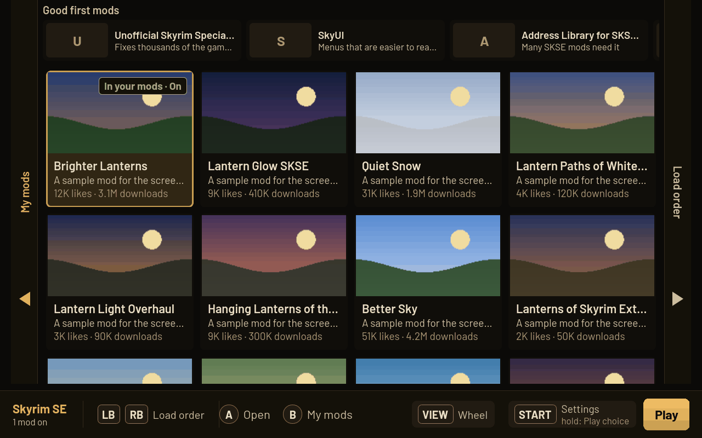
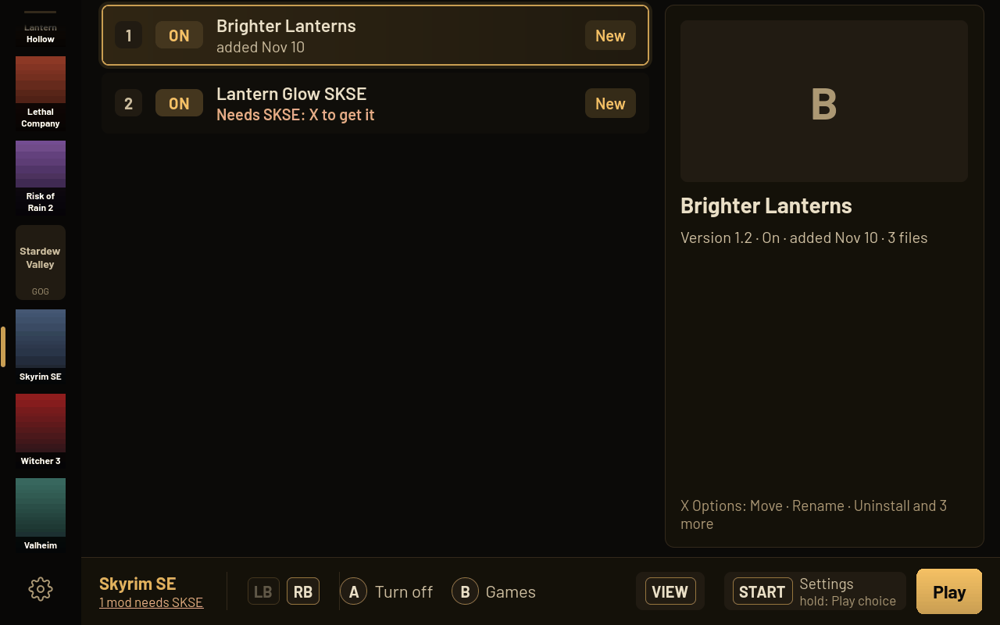
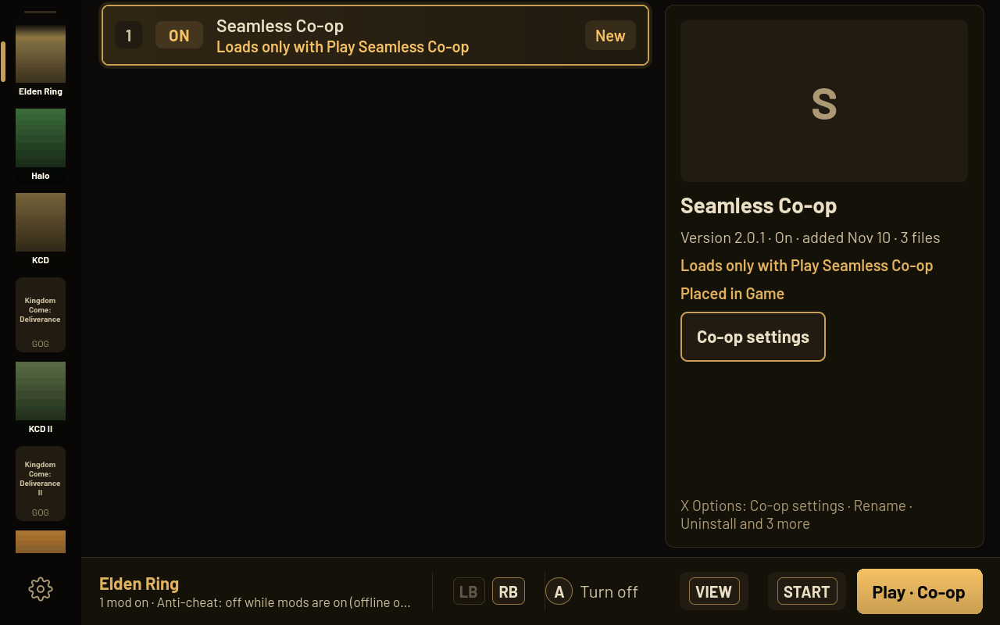
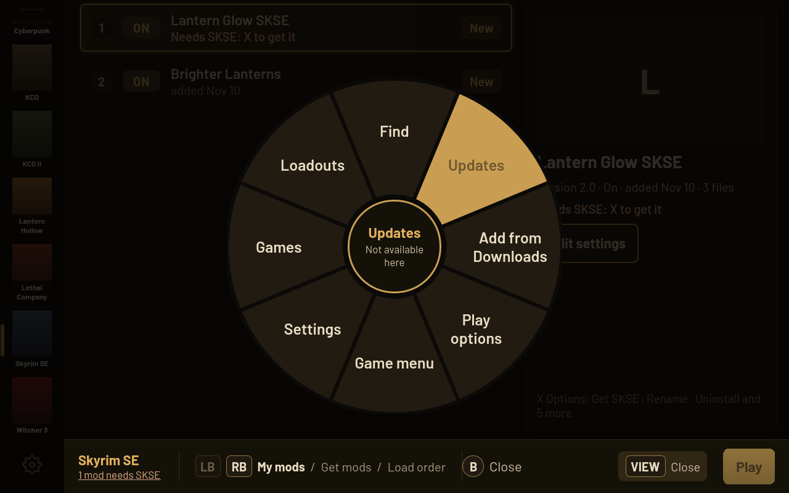

<b>Mod any of your games on a SteamOS handheld. From the couch, in Game Mode, with the controller.</b>

  <a href="https://github.com/Ravenor907/Turbine-Mod-Manager/releases/latest/download/TurbineModManager.flatpak"><b>Download</b></a>
  &nbsp;·&nbsp; <a href="https://github.com/Ravenor907/Turbine-Mod-Manager/releases">Releases</a>
  &nbsp;·&nbsp; <a href="https://ravenor907.github.io/Turbine-Mod-Manager/">Website</a>
  &nbsp;·&nbsp; <a href="https://github.com/Ravenor907/Turbine-Mod-Manager/issues">Report a problem</a>

Pick a game, find a mod, press Play. Turbine handles where the files go, what each mod needs, and how to take it all
back out.

## Features

- **Your whole library.** Steam and Heroic games (Epic and GOG), on internal storage or an SD card. Games Turbine has
  no rules for still work: it reads a mod's files to see where they go, and asks once when it can't tell.
- **Get mods in the app.** Nexus Mods built in, with pictures, likes and downloads. Thunderstore for the games that
  use it, plus zip, 7z and rar files you already have. A free Nexus account works.
- **Load orders and installers.** Skyrim's plugin load order with one-press sort, mod installers with their choices
  on screen, and script loaders (SKSE, SMAPI, BepInEx) from their official sources.
- **Frameworks, checked.** Cyberpunk 2077's RED4ext, Cyber Engine Tweaks, ArchiveXL and TweakXL checked before Play.
  The Witcher 3's mod priority and script conflicts, Kingdom Come's mod order.
- **FromSoftware games.** Elden Ring, Nightreign, Armored Core VI, Dark Souls III and Sekiro run mods through me3,
  game folder untouched, started from Steam's own Play. Elden Ring's Seamless Co-op is chosen right at Play.
- **Needs and updates.** See what each mod needs and which mods need it. Mod updates from Nexus and Thunderstore in
  one place. Turbine updates itself.
- **Safe, with one-press undo.** Turbine only removes files it placed, backs up any game file a mod replaces, and backs
  up your saves before a modded Play. Play without mods, go back to a setup that worked, or turn every mod off.
- **Loadouts.** Named setups per game. Share one as a file or a Thunderstore code.
- **Made for your hands.** Controller first, with touch, keyboard and mouse just as good. Optional Steam menu plugin
  (Decky) for mods on or off from Quick Access.

  
  
  
  

Real Turbine screens with made-up sample mods.

## Games

- **Full support:** Skyrim Special Edition, Cyberpunk 2077, The Witcher 3, Kingdom Come: Deliverance I and II,
  Stardew Valley, Valheim, Lethal Company, Risk of Rain 2.
- **Through me3:** Elden Ring, Elden Ring Nightreign, Armored Core VI, Dark Souls III, Sekiro.
- **Every other Steam and Heroic game:** Basic support.
- **Never modded:** games that need their anti-cheat online, such as Apex Legends, Destiny 2 and Fortnite.

## Install

1. In Desktop Mode, download [TurbineModManager.flatpak](https://github.com/Ravenor907/Turbine-Mod-Manager/releases/latest/download/TurbineModManager.flatpak).
2. Double-click it in Downloads and press **Install** in Discover. The first install takes a few minutes.
3. Right-click **Turbine Mod Manager** in the app launcher and choose **Add to Steam**.
4. Go back to Game Mode. Turbine is in your Library under **Non-Steam**.

Prefer a terminal? `flatpak install --user ~/Downloads/TurbineModManager.flatpak`

**Steam menu plugin (optional):** in Decky, open the gear, then Developer, then **Install Plugin From URL**, and paste:
`https://github.com/Ravenor907/Turbine-Mod-Manager/releases/latest/download/Turbine-Decky.zip`

## Controls

| Do | Controller | Keyboard | Mouse |
| --- | --- | --- | --- |
| Select | A | Enter or Space | Click |
| Back | B | Esc | Back side button |
| Options | X | R | Right-click |
| Find | Y | F | |
| Pages | LB / RB | Q / E | Page names, Forward side button |
| Page up and down | LT / RT | | Wheel |
| Quick wheel | View | Hold Tab | |
| Settings | Start | Esc on a game's first page | |
| Play | Hold Start 3 seconds, or A on Play | Hold Space 3 seconds | Click Play |
| Pointer | Right stick | | Mouse |
| Interface size | | Ctrl and + or - | Ctrl and wheel |

The hints at the bottom follow whatever you used last. Touch works for everything.

## Help

Something not working? In Turbine open Settings, Help, **Report a problem** and press **Save report**. Then
[open an issue](https://github.com/Ravenor907/Turbine-Mod-Manager/issues/new) and attach the file. It holds no keys or
passwords. More answers on the [website](https://ravenor907.github.io/Turbine-Mod-Manager/#faq).

[Releases](https://github.com/Ravenor907/Turbine-Mod-Manager/releases) · [Issues](https://github.com/Ravenor907/Turbine-Mod-Manager/issues) · Free software under the GNU GPL, version 3 or later. See [LICENSE](LICENSE).
